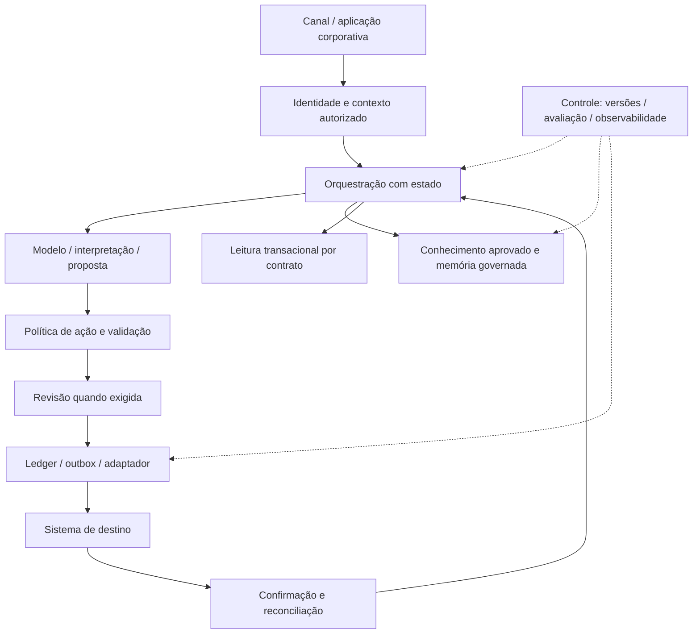

# Arquitetura de referência para sistemas corporativos com IA

**Escopo:** desenho independente para uma operação B2B fictícia. Apresenta decisões e contratos para revisão de engenharia; não expõe a topologia de um cliente nem declara implantação integral em produção. As implementações locais estão identificadas na matriz ao final.

## Problema arquitetural

O mesmo atendimento pode exigir interpretação de linguagem, consulta documental, leitura transacional e uma operação com efeito externo. Cada caminho possui uma fonte de autoridade, um contrato de falha e um critério de conclusão diferente. Meu desenho mantém essas responsabilidades explícitas.

## Planos e responsabilidades

| Plano | Responsabilidade | Autoridade preservada |
|---|---|---|
| Identidade | Resolver organização, sujeito, papéis e finalidade | O modelo não escolhe o tenant ou concede a própria permissão |
| Conhecimento | Recuperar conteúdo permitido, aprovado e vigente | Um trecho recuperado não autoriza ação nem altera política |
| Decisão | Interpretar intenção, propor caminho e validar saída | Regras determinísticas decidem admissibilidade e efeitos |
| Execução | Registrar intenção, adquirir reserva e confirmar resultado | O destino confirma o estado transacional |
| Controle | Identificar versão, avaliar regressão e observar falhas | Promoção depende de evidência adequada à camada |

## Contratos nas fronteiras

| Contrato | Campos mínimos de referência | Rejeição relevante |
|---|---|---|
| Contexto autorizado | organização, sujeito, papéis, finalidade, validade | Contexto vencido ou escopo divergente |
| Evidência documental | fonte, versão, revisão, vigência, escopo, trecho | Fonte revogada, incompatível ou sem aprovação |
| Proposta de ação | operação, parâmetros, versão da política, digest | Campos extras, ação fora de escopo ou parâmetros ambíguos |
| Decisão de revisão | proposta, digest, decisão, identidade verificada | Aprovação sem vínculo ou aplicada a proposta alterada |
| Recibo operacional | organização, operação, referência do destino, estado | Resultado não correlacionado ou status sem semântica de conclusão |

São contratos de referência. Os nomes não reproduzem schemas comerciais. A identidade e a autorização precisam ser verificadas antes de construir esses envelopes.

## Conhecimento, memória e estado transacional

**Conhecimento documental** descreve informação revisada e versionada. Busca lexical e vetorial podem gerar candidatos; autorização, vigência e classificação delimitam o conjunto permitido. Fusão e reranking são decisões de relevância posteriores ao escopo. Um índice vetorial não substitui política de acesso.

**Memória conversacional** preserva contexto com origem, validade e finalidade. Um atributo lembrado não ganha autoridade para modificar cadastro. Expiração, revogação e exclusão devem alcançar derivados e caches relevantes; retenção exige decisão explícita.

**Estado transacional** pertence ao sistema responsável pela operação. Disponibilidade, cadastro e confirmação devem vir de conectores com contratos específicos. A resposta do agente precisa refletir o estado observado, incluindo incerteza e indisponibilidade.

## Execução e consistência

A proposta é registrada antes de qualquer despacho. A aprovação fica vinculada ao conteúdo e à versão da política. Um dispatcher adquire reserva exclusiva, utiliza correlação estável e registra o resultado. Se houver dúvida sobre o efeito externo, a operação entra em reconciliação.

Não há transação atômica entre um checkpoint do agente e um serviço externo arbitrário. Defino a fonte de verdade da execução, a janela de duplicidade e a estratégia de recuperação. A referência local de [ledger](../src/portfolio_lab/execution.py) demonstra persistência e transições; o [grafo LangGraph](../src/portfolio_lab/workflow.py) demonstra interrupção e retomada. São referências separadas, sem integração end-to-end alegada.

## Falhas que mudam a decisão

| Evento | Resposta arquitetural | Por que importa à operação |
|---|---|---|
| Conhecimento sem fonte admissível | Abstenção ou continuidade humana | Evita orientar a jornada com informação sem autoridade |
| Fonte documental e sistema divergem | Priorizar fonte competente e registrar divergência | Evita usar informação antiga em decisão transacional |
| Conector excede deadline | Indicar indisponibilidade ou resultado incerto | Evita declarar conclusão sem confirmação |
| Modelo pede ferramenta não permitida | Negar fora do modelo e registrar motivo | Contém efeito mesmo com resposta inadequada |
| Aprovação perde validade por mudança | Invalidar e exigir nova decisão | Impede executar conteúdo diferente do revisado |
| Worker cai durante despacho | Quarentena e reconciliação | Reduz risco de efeito duplicado |
| Dependência muda contrato | Bloquear promoção ou adaptar com compatibilidade | Preserva jornadas existentes |

## Compromissos deliberados

- **Workflow explícito antes de autonomia ampla:** transições e saídas por estado tornam a execução revisável. Autonomia só cresce com evidência e responsabilidade definidas.
- **Adapter por domínio antes de ferramenta universal de escrita:** contratos específicos restringem dados, permissões e efeitos admissíveis.
- **Baseline lexical antes de ganho semântico presumido:** a recuperação avançada precisa demonstrar melhora no conjunto de consultas da operação.
- **Correlação antes de declaração de sucesso:** aceitação HTTP, entrega e conclusão empresarial podem representar estados distintos.
- **Idempotência local sem promessa de exatamente uma vez:** o contrato do destino decide o que se pode garantir fora do processo.

## O que está implementado neste portfólio

| Componente | Referência executável | Escopo |
|---|---|---|
| Contratos e fontes | `contracts.py`, `retrieval.py` | Corpus fictício, busca lexical e validação de citações |
| Workflow | `workflow.py` | LangGraph real, checkpointer em memória, efeito fictício |
| Ferramentas | `mcp_server.py`, `mcp_probe.py` | SDK MCP real, transporte stdio, ferramentas de leitura/proposta |
| Ledger/outbox | `execution.py` | SQLite em arquivo, transações e testes locais de falha |
| Grafo de dependências | `provenance.py` | Estrutura, impacto e prevenção de ciclos |
| Dataset | `datasets.py` | Dados sintéticos, validação e split por grupo |
| Harness | `evaluate.py`, testes | Cenários determinísticos e integração local dos SDKs |

Autenticação, busca vetorial, LLM real, infraestrutura distribuída, criptografia e conectores comerciais pertencem ao desenho de referência; não são apresentados como componentes implantados neste código.

Referências: [MCP — segurança](https://modelcontextprotocol.io/docs/2025-11-25/tutorials/security/security_best_practices), [LangGraph — interrupção e retomada](https://docs.langchain.com/oss/python/langgraph/interrupts), [SQLite — transações](https://www.sqlite.org/lang_transaction.html).
