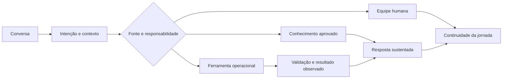

# Atendimento em saúde — agentes, conhecimento e integração operacional

**Contexto:** clínica de diagnóstico por imagem. **Atuação:** diagnóstico, arquitetura, desenvolvimento, integração e evolução de uma solução de atendimento em uma operação real.

Este é um projeto profissional com sistemas, regras de negócio e usuários reais. O código comercial permanece privado. Os diagramas desta página são abstrações para explicar as decisões sem divulgar a implementação do cliente.

## O problema empresarial

Um atendimento útil precisa atravessar a jornada: entender a solicitação, consultar informação competente, trabalhar com cadastro e agenda, reconhecer restrições e manter continuidade com a equipe. Uma resposta convincente perde valor se não corresponde ao que o sistema operacional permite executar.

A complexidade está na combinação de linguagem informal, dados sensíveis, regras específicas da operação e integrações com estados próprios. Minha atuação conecta esses requisitos ao desenho e ao desenvolvimento dos componentes que sustentam a jornada.

## Minha atuação direta

| Frente | Trabalho de engenharia |
|---|---|
| Diagnóstico e desenho de solução | Transformar necessidades de atendimento em fluxos, requisitos, responsabilidades e critérios de aceite. |
| Desenvolvimento de agentes | Construir comportamento conversacional, contratos de ferramentas, validações e caminhos de continuidade humana. |
| Integração operacional | Conectar a conversa às funções de cadastro, consulta de agenda e sistemas da operação, respeitando contratos e autoridade. |
| Conhecimento e contexto | Estruturar recuperação de conteúdo aprovado, fontes, versões e memória com limites explícitos de uso. |
| Qualidade e avaliação | Construir cenários, harnesses e regressões; distinguir comportamento do modelo, contrato determinístico e confirmação operacional. |
| Evolução técnica | Trabalhar com dependências, rastreabilidade, documentação de decisões e critérios de release. |
| Voz e telefonia | Desenvolver a expansão do atendimento para URAs cognitivas, voicebots e continuidade com a equipe; arquitetura e integração com a jornada. |

Minha contribuição envolve desenvolvimento e integração, além da definição arquitetural. O problema exige acompanhar o caminho entre intenção do usuário, comportamento do agente e estado do sistema de destino.

## 1. Autoridade: decidir de onde cada informação deve vir

Conhecimento institucional, memória e dados transacionais cumprem funções diferentes. A recuperação documental trabalha com informação aprovada e versionada; o sistema de gestão responde pelo estado operacional. Memória fornece contexto, sem assumir autoridade sobre cadastro ou permissão.

| Necessidade | Fonte competente | Critério de resposta |
|---|---|---|
| Informação institucional admissível | Conhecimento revisado e vigente | Fonte rastreável e conteúdo dentro do escopo |
| Contexto de continuidade | Memória com origem e finalidade | Uso compatível com a jornada e a política de retenção |
| Disponibilidade ou estado de cadastro | Ferramenta transacional específica | Retorno observado e contrato válido |
| Operação com efeito externo | Sistema de destino | Confirmação correlacionada, não apenas intenção do agente |

Essa separação orienta a arquitetura e as validações. Um modelo pode interpretar uma solicitação; a informação que sustenta a operação precisa vir da fonte competente.

## 2. RAG e memória: governar o conhecimento antes da geração

O trabalho técnico inclui registro de fontes, aprovação, vigência, escopo e proveniência. A documentação do projeto organiza recuperação lexical e evolução semântica sob critérios de avaliação e promoção. O conhecimento documental tem limites de responsabilidade; fatos voláteis e ações permanecem em ferramentas determinísticas.

A decisão de engenharia é preservar o vínculo entre consulta, evidência e resposta. Busca avançada só agrega valor quando melhora relevância e cobertura sem ultrapassar permissões ou substituir informação transacional.

## 3. Integração: tratar o atendimento como execução operacional

A resposta precisa refletir a operação observada. Aceitação por um provedor, atualização de um sistema e entrega ao usuário podem exigir evidências distintas. Correlação e estados explícitos permitem identificar falhas de integração e decidir a recuperação adequada.

## 4. Qualidade: avaliar cada camada com o instrumento certo

| Camada | O que deve ser verificado |
|---|---|
| Conversa | Entendimento da intenção, clareza, informação ausente, ambiguidade e continuidade |
| Conhecimento | Fonte admissível, versão, citação, conflito e abstenção |
| Regras e ferramentas | Entrada válida, permissão, restrição de negócio e efeito permitido |
| Integração | Retorno correlacionado e estado observado no destino |
| Operação | Release coerente, diagnóstico de falhas e capacidade de reversão |

Harnesses são instrumentos de engenharia dentro do projeto real. Sua função é permitir evolução com critério; a experiência profissional não se resume à construção desses instrumentos.

## 5. Grafos, orquestração e rastreabilidade

Graphify apoia o mapa estrutural, a navegação, a proveniência e a análise de dependências do projeto. Grafos ajudam a localizar componentes e avaliar impacto de mudanças; orquestração com estado explicita transições, continuidade e pontos de revisão. A [arquitetura de dados e grafos](../dados-e-grafos.md) detalha essas responsabilidades e suas relações com persistência e recuperação de conhecimento.

## 6. Voz e telefonia — URAs cognitivas e voicebots

A frente de voz amplia o atendimento para URAs cognitivas e voicebots, conectando a camada telefônica aos agentes, ao contexto e às ferramentas operacionais. Minha atuação inclui desenho arquitetural, desenvolvimento de controle de chamadas e integração com atendimento humano.

O repertório reúne **OpenAI Voice/Realtime, Google Cloud Speech-to-Text e ElevenLabs API**, combinado com **Asterisk, SIP.js, SIP/WebRTC e persistência PostgreSQL**. A arquitetura diferencia telefonia, mídia, interpretação, conhecimento, ferramentas e confirmação operacional; cada componente tem responsabilidade própria.

O [dossiê de voz e telefonia](../voz-telefonia.md) apresenta alternativas speech-to-speech e STT → agente → TTS, continuidade humana e critérios de homologação. O dossiê descreve componentes, responsabilidades e critérios de integração e liberação do canal telefônico.

## 7. Design da experiência conversacional

A jornada conecta persona, tom de voz, UX Writing e microcopy a regras operacionais e critérios de aceite. Menus claros, fallbacks e orientações acessíveis apoiam diferentes níveis de literacia digital. Curadoria de intenções e entidades, documentação de árvores de decisão e matrizes de intenção sustentam o desenho e sua avaliação.

Minha atuação em design conversacional inclui Discovery com stakeholders, prototipação em Figma/Miro/Visio e homologação em Staging com Desenvolvimento/QA. O [dossiê conversacional](../design-conversacional.md) explicita esse repertório e como retenção, transbordo, CSAT, NPS e reconhecimento orientam melhorias, sem atribuir resultados numéricos não medidos ao cliente.

## Valor empresarial

A solução conecta atendimento a processos que a equipe realmente precisa executar. Os objetivos de valor são continuidade da jornada, informação consistente, integração com a rotina e redução de retrabalho. Meu repertório comercial ajuda a tratar o atendimento também como relação com o cliente e capacidade operacional da empresa.

O portfólio apresenta o trabalho e as decisões do projeto real. Não atribui percentuais de conversão, economia ou disponibilidade sem medição aprovada pelo cliente.

## Divulgação responsável

A síntese utiliza experiência profissional e documentação técnica do projeto revisada em outubro de 2026. Não expõe dados de pacientes, topologia operacional, prompts comerciais, regras específicas, credenciais ou código do produto. Não é uma auditoria atual de produção.

Para revisão de código, a [referência independente](../laboratorio.md) demonstra mecanismos selecionados em domínio fictício. Ela é material complementar; este estudo descreve o projeto profissional real.
