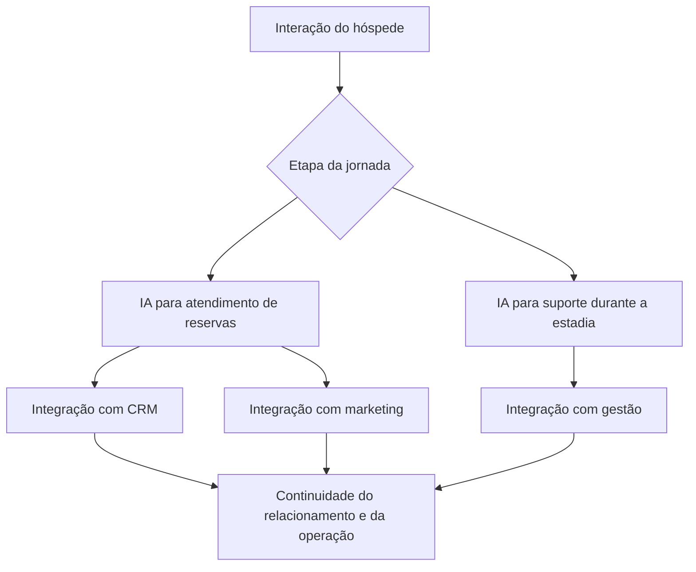

# Atendimento em hotelaria — reservas, suporte ao hóspede e integração empresarial

**Projeto real nos Estados Unidos · Arquitetura, desenvolvimento e integração de soluções de IA · Reservas, suporte durante estadias, CRM, marketing e gestão**

Em uma operação de hotelaria nos Estados Unidos, desenvolvi uma solução de atendimento com IA para acompanhar o hóspede na jornada de reserva e no suporte durante a estadia. Integrei essa atuação a CRM, marketing e gestão, conectando experiência do cliente, relacionamento comercial e operação.

A solução conecta agentes a processos e sistemas de hotelaria e gestão de casas de temporada. A jornada envolve aquisição, reserva, estadia e continuidade do relacionamento, com responsabilidades específicas em cada integração.

## O problema empresarial

O atendimento antes da reserva e o suporte durante a estadia precisam de comportamentos e informações diferentes. Na primeira jornada, o hóspede procura orientação para decidir e reservar. Durante a estadia, precisa resolver necessidades concretas e obter continuidade no suporte.

Essas interações também precisam produzir informação utilizável no CRM, no marketing e na gestão. Minha atuação foi conectar o atendimento ao funcionamento da empresa, desenvolvendo a solução de IA e suas integrações.

## Minha atuação direta

| Frente | Escopo do trabalho |
|---|---|
| Arquitetura da solução | Organizar a conexão entre atendimento, reservas, suporte e sistemas empresariais. |
| Desenvolvimento de IA para reservas | Construir o atendimento à jornada comercial de reserva, considerando intenção e contexto do hóspede. |
| Desenvolvimento de IA para estadias | Construir o suporte ao hóspede durante a permanência, com continuidade entre conversa e operação. |
| Integração com CRM | Conectar atendimento e relacionamento ao contexto comercial e de acompanhamento. |
| Integração com marketing | Conectar a jornada de atendimento às necessidades de aquisição, comunicação e relacionamento. |
| Integração com gestão | Conectar solicitações e contexto do hóspede às rotinas e responsabilidades operacionais. |

A contribuição envolveu desenvolvimento e integração de soluções, além da coordenação e do desenho dos processos.

## 1. IA para reservas: atendimento e jornada comercial

A IA foi desenvolvida para atender hóspedes no contexto de reservas. Essa jornada conecta entendimento da solicitação, orientação e continuidade comercial. O CRM e o marketing integram o contexto empresarial dessa experiência.

Minha experiência em vendas e marketing contribui para traduzir a intenção do hóspede em requisitos do sistema: qual informação ajuda a decisão, o que precisa acompanhar o relacionamento e como preservar coerência entre comunicação e operação.

## 2. IA para suporte durante as estadias

A solução também foi desenvolvida para apoiar o hóspede durante a estadia. Nesse momento, a prioridade passa a ser suporte e resolução operacional: compreender a necessidade, preservar o contexto e conectar o atendimento à gestão.

A distinção entre essas jornadas importa à engenharia. Um contato comercial e uma solicitação de suporte não devem receber o mesmo tratamento apenas porque chegam pelo mesmo canal. O comportamento do agente precisa considerar a etapa da experiência e a responsabilidade pelo próximo passo.

## 3. Integração com CRM, marketing e gestão

| Integração | Papel na solução | Relação com o negócio |
|---|---|---|
| CRM | Conectar atendimento e contexto de relacionamento | Continuidade comercial e acompanhamento do hóspede |
| Marketing | Conectar comunicação, aquisição e jornada de atendimento | Coerência entre atração, orientação e relacionamento |
| Gestão | Conectar suporte e necessidades operacionais | Visibilidade e responsabilidade pela continuidade |

O valor da integração está no caminho entre uma conversa e a informação que outra parte da empresa precisa utilizar. Essa conexão exige compreender tanto os sistemas quanto o processo e a equipe responsável.

## 4. Visão de engenharia da jornada

O diagrama abaixo é uma abstração funcional do escopo do projeto. Não reproduz a topologia comercial nem identifica plataformas, endpoints ou regras internas.

A leitura técnica distingue interpretação da intenção, informação necessária ao atendimento e responsabilidades dos sistemas integrados. O contexto do hóspede precisa ser útil ao próximo passo; a comunicação deve refletir o que a operação consegue assumir.

## 5. Diferencial: técnica e negócio na mesma entrega

O projeto reúne competências que precisam trabalhar em conjunto: desenvolvimento de IA, arquitetura de integrações, compreensão da experiência do hóspede e visão comercial. Minha atuação conecta a conversa à jornada empresarial, desde a reserva até o suporte durante a estadia.

Esse contexto amplia minha experiência de engenharia para além de um único setor. Saúde e hotelaria têm regras e usuários diferentes, mas ambas exigem soluções conectadas à operação e ao relacionamento com o cliente.

## Valor empresarial

A solução foi desenvolvida para integrar atendimento de reservas, suporte aos hóspedes e sistemas da empresa. Continuidade do relacionamento, informação utilizável pelas equipes e conexão entre experiência e gestão são os objetivos empresariais desse desenho.

Resultados quantitativos de reservas, receita, custos ou satisfação só devem ser publicados com medição e autorização específicas. Este estudo apresenta o projeto realizado e sua abrangência, sem atribuir números não fornecidos.

## Fonte e divulgação

Experiência profissional descrita no currículo e escopo confirmado diretamente por André em 05/10/2026: IA para reservas e suporte durante estadias, integrada a CRM, marketing e gestão. O estudo preserva código comercial, dados de hóspedes, estratégias de marketing e regras internas. A stack e as versões específicas não são inferidas a partir do projeto de saúde.

[Projeto de saúde](atendimento-saude.md) · [Conexão entre negócio e engenharia](../abordagem.md) · [Retornar ao portfólio](../../README.md)
