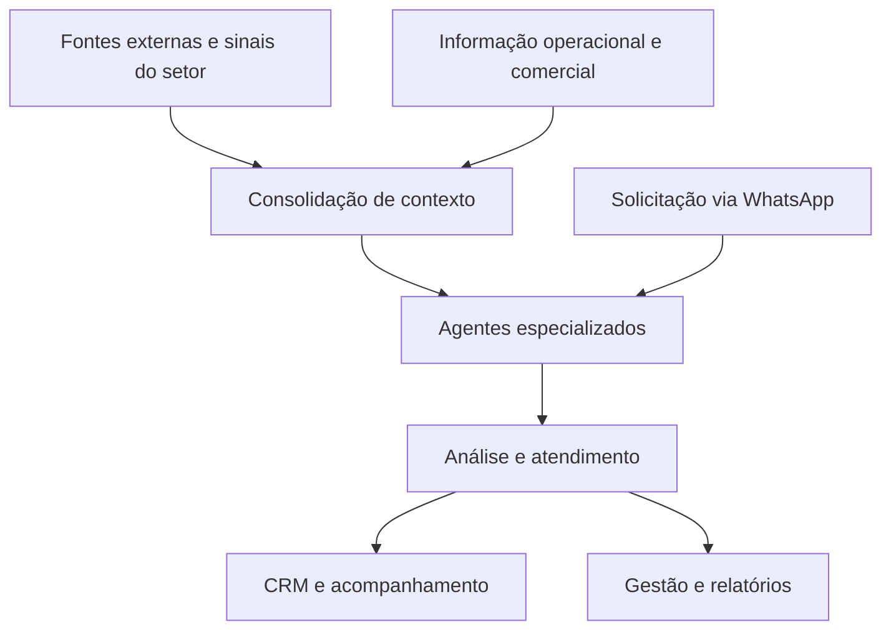

# Inteligência multiagente — engenharia de IA para inteligência operacional e comercial no agronegócio

**Produto próprio · Arquitetura multiagente · Integração de dados · Operação proativa e atendimento reativo · CRM e gestão**

A solução integra sinais do agronegócio ao contexto de clientes e da operação para produzir análise utilizável pelo negócio. Meu trabalho conecta arquitetura de agentes, orquestração, persistência e integração à leitura comercial do setor.

## O problema empresarial

Sinais climáticos, preços, câmbio, documentos e histórico comercial chegam de fontes diferentes. Consultar cada fonte isoladamente não resolve a necessidade da equipe: saber qual contexto merece atenção, qual oportunidade deve ser acompanhada e como levar a informação ao relacionamento com o cliente.

O projeto organiza essas dimensões em uma solução de inteligência operacional, comercial e climática, com atendimento e acompanhamento recorrente.

## Minha atuação

| Frente | Trabalho de engenharia e produto |
|---|---|
| Arquitetura de IA | Organizar agentes especializados e consolidar contexto para análise e atendimento. |
| Orquestração | Desenvolver fluxos com n8n para operação recorrente e entrada reativa. |
| Integração de dados | Conectar fontes externas e informação operacional/comercial da empresa. |
| Persistência e contexto | Trabalhar com PostgreSQL, Supabase e Redis para informação, histórico e contexto de sessão. |
| Experiência de uso | Conectar inteligência ao WhatsApp, CRM e apresentação dos resultados à gestão. |
| Produto e estratégia comercial | Traduzir capacidades técnicas em aplicações para risco, oportunidade e relacionamento. |

## 1. Especialização dos agentes e consolidação do contexto

A apresentação do produto organiza frentes de inteligência climática, comercial, documental e de insumos/câmbio. O desafio de engenharia é coordenar essas especialidades sem perder o vínculo com o contexto que sustenta a análise.

Especialização é uma decisão de responsabilidade: cada frente trabalha com informação pertinente ao seu domínio; a consolidação precisa preservar origem e significado para produzir uma orientação coerente.

## 2. Dois modos de operação

| Modo | Função | Necessidade de engenharia |
|---|---|---|
| Proativo | Monitoramento e análise em ciclos programados | Orquestração, consolidação de fontes e encaminhamento do resultado |
| Reativo | Atendimento pelo WhatsApp a partir da solicitação | Interpretação, contexto e continuidade da conversa |

A apresentação do produto também descreve entradas multimodais. A síntese pública deste portfólio preserva o escopo funcional, sem reproduzir prompts, configurações ou estratégias de processamento.

## 3. Da informação ao trabalho comercial

A conexão com CRM e gestão coloca o contexto de risco e oportunidade no fluxo de acompanhamento da empresa. Minha experiência comercial ajuda a reconhecer a diferença entre uma informação interessante e uma informação que modifica a prioridade da equipe.

O projeto reúne desenvolvimento de IA e compreensão de aquisição, relacionamento, carteira de clientes e operação. Essa combinação orienta o desenho das entregas de inteligência.

## 4. Abstração funcional

O diagrama explica responsabilidades em alto nível. Não publica topologia, fórmulas de priorização, regras de detecção, schemas ou conectores comerciais.

## Diferencial demonstrado pelo projeto

- Engenharia de sistemas multiagentes aplicada a um domínio empresarial específico.
- Integração entre dados, contexto, atendimento e acompanhamento da operação.
- Desenvolvimento que combina necessidades técnicas e oportunidades comerciais.
- Construção de produto próprio, incluindo arquitetura e leitura de aplicação empresarial.

## Fonte e divulgação

Projeto incluído por solicitação de André. Escopo sintetizado a partir da apresentação existente da solução de inteligência setorial e dos materiais de desenvolvimento consultados em 05/10/2026. Descrições publicadas pelo produto não são tratadas como auditoria atual do runtime. Não se reproduzem números de receita potencial, previsões, índices de sucesso, certificações ou promessas de desempenho.

[Estratégia e engenharia](../abordagem.md) · [Retornar ao portfólio](../../README.md)
