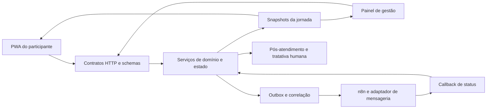

# Plataforma de jornada hospitalar — PWA, backend de estados e gestão operacional

**Desenvolvimento full stack · Next.js · React · TypeScript · Máquina de estados · Snapshots · Outbox · n8n · Evolution API**

Desenvolvi uma aplicação com duas superfícies conectadas: experiência mobile do participante e painel autenticado de gestão. O backend organiza a progressão da jornada, publica snapshots do estado e mantém contratos específicos para eventos de atendimento, pós-atendimento e mensageria.

O trabalho reúne desenvolvimento de interfaces, modelagem de domínio, contratos HTTP, validação de payloads e integração assíncrona. A consistência entre aplicativo, painel e comunicação externa é uma responsabilidade central da arquitetura.

## Componentes e funções desenvolvidas

| Componente | Função | Questão de engenharia |
|---|---|---|
| PWA do participante | Apresentar preparo, chegada, espera, chamada, atendimento e continuidade | Representar o estado que o backend autoriza e o próximo passo da jornada |
| Painel de gestão | Acompanhar etapas, pendências e necessidades de intervenção | Ler o mesmo contexto operacional usado pela experiência mobile |
| Máquina de estados | Modelar etapas, eventos e transições | Preservar coerência entre estado atual, comando recebido e resultado permitido |
| Serviço de jornada | Processar comandos e construir snapshots | Centralizar responsabilidade pelo estado e pela resposta das interfaces |
| Contratos HTTP | Validar entradas e eventos de integração | Usar schemas tipados para rejeitar payloads incompatíveis |
| Outbox de mensageria | Desacoplar evento da jornada e envio de comunicação | Correlacionar tentativa, retorno e situação da entrega |
| Pós-atendimento | Registrar experiência e acompanhar tratativa humana | Preservar histórico entre avaliação, resolução e retorno |
| Apoio operacional | Apresentar recomendações com contexto e evidência | Distinguir leitura analítica, ação proposta e responsabilidade da equipe |

## Estado compartilhado entre aplicativo e gestão

Modelei o fluxo de domínio no backend e a leitura por snapshots, para que as duas superfícies interpretem uma referência comum de estado. O núcleo de desenvolvimento utiliza memória do processo e atualização por consulta; essa implementação permite avaliar o contrato e a progressão do fluxo.

O domínio separa jornada, atendimento e pós-atendimento. O aplicativo apresenta o próximo passo; a gestão acompanha exceções; os serviços de integração recebem eventos sob schemas próprios. Essa organização permite evoluir interfaces e conectores sem transferir regras de negócio para cada canal.

## Mensageria como integração assíncrona

A comunicação utiliza adaptadores para **n8n e Evolution API**, com fluxos próprios de progresso da jornada e pós-atendimento. Webhooks de envio e callbacks de status cumprem papéis diferentes e têm autenticação específica. Templates delimitados e controles de deduplicação restringem o efeito permitido.

O outbox conecta evento, tentativa de envio e retorno da integração. Um snapshot lido pelo painel informa o estado da aplicação; confirmação de entrega depende do transporte e de seu retorno correlacionado. Essa separação orienta diagnóstico, repetição e tratamento de indisponibilidade.

## Persistência, identidade e infraestrutura de dados

| Tecnologia | Papel no projeto e estágio |
|---|---|
| Next.js, React e TypeScript | Aplicação web, componentes mobile, painel e backend |
| Zod | Schemas de validação nas fronteiras HTTP e de integração |
| Tailwind CSS | Organização visual dos componentes e superfícies |
| PostgreSQL/Supabase | Dependências e camada de integração previstas para persistência, identidade e evolução do estado |
| Redis | Dependência para infraestrutura de estado temporário e evolução da coordenação |
| n8n e Evolution API | Adaptadores de orquestração e comunicação pelo WhatsApp |
| Vitest e Playwright | Ferramentas de verificação unitária, integrada e de interface configuradas no projeto |

A dependência de uma biblioteca identifica o repertório do código; ativação, persistência durável e operação dos serviços exigem configuração e validação no ambiente correspondente. O núcleo consultado mantém estado em memória e não sustenta a declaração de uma implantação hospitalar completa.

## Continuidade e responsabilidade operacional

O pós-atendimento inclui registro da experiência, abertura de tratativa humana e continuidade após a resolução. O histórico preserva o registro original, permitindo acompanhar a recuperação sem substituir a experiência já informada.

A evolução para uma operação conduzida pela equipe coloca eventos assistenciais sob responsabilidade de operador autenticado ou integração competente. Esse desenho evita que uma mudança de tela ou um temporizador se torne, por si só, confirmação de um fato do atendimento.

## Arquitetura funcional compartilhável

## Contribuição técnica e valor empresarial

Entreguei a jornada como aplicação utilizável, com interfaces conectadas a um backend e contratos de integração. O desenvolvimento transforma um processo de serviço em estados, comandos, eventos e superfícies de acompanhamento. Isso permite discutir experiência, operação e evolução tecnológica a partir de comportamento implementado.

## Base documental e divulgação

README, dependências e estrutura de componentes consultados em 05/10/2026. A síntese descreve desenvolvimento e decisões do produto; os estágios de integração são indicados acima. Não publica dados de participantes, parâmetros de priorização, políticas comerciais, endpoints privados ou código proprietário.

[Plataformas corporativas e agentes de suporte](plataformas-corporativas.md) · [Dados e grafos](../dados-e-grafos.md) · [Retornar ao portfólio](../../README.md)
