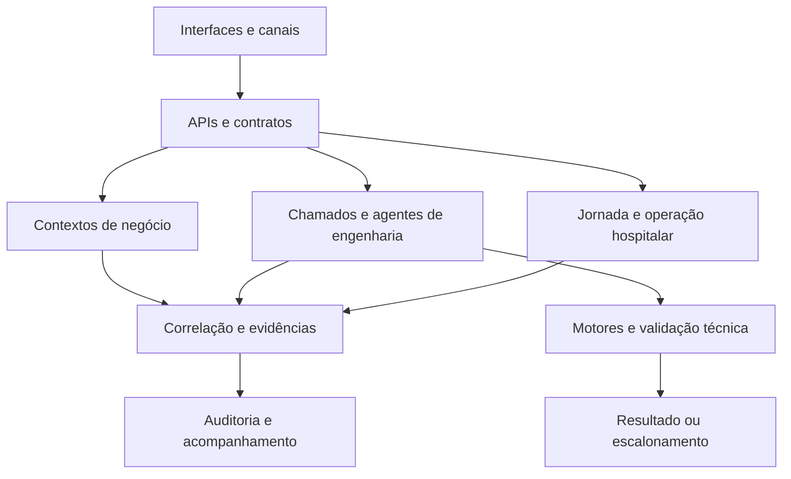

# Plataformas corporativas — domínios de negócio, agentes de engenharia e operação

**Node.js/JavaScript · Python/FastAPI · SDKs de agentes · Multi-tenancy · Contratos tipados · Auditoria · Outbox · Reconciliação · Interfaces operacionais**

Desenvolvo sistemas próprios com três responsabilidades distintas: coordenação dos domínios de negócio, execução de suporte técnico com agentes e acompanhamento da jornada hospitalar. A arquitetura define quem controla o estado, quem pode executar uma ação e qual evidência sustenta sua conclusão.

## Plataforma modular de gestão empresarial

### Arquitetura e componentes

Implementei uma fundação em **Node.js e JavaScript com módulos ESM**, organizada como monólito modular. API, serviços de aplicação, contextos de domínio e composição executiva têm responsabilidades separadas. Os módulos abrangem agentes, receita, contratos, entrega, capacidade, financeiro, documentos, agenda, atendimento e indicadores.

O modelo inclui organização, tenant, principal e habilitação de capacidades. IDs de correlação relacionam comandos, eventos, evidências e histórico. Aprovações humanas entram no ciclo de vida das operações sensíveis, e auditoria/outbox conectam mudanças de estado ao acompanhamento no cockpit.

| Domínio | Funções desenvolvidas | Decisão técnica |
|---|---|---|
| Agentes e telemetria | Registrar atividade estruturada e solicitações de ciclo de vida | Usar referências pseudônimas e metadados, com escopo por organização |
| Receita e contratos | Qualificar lead, acompanhar negócio e registrar aprovação contratual | Manter estágios explícitos e distinguir contrato de lançamento financeiro |
| Entrega e capacidade | Vincular projeto a contrato, reservar capacidade e acompanhar marcos | Controlar duplicidade e relacionar aceite a evidência e aprovação |
| Financeiro | Registrar recebíveis, obrigações, lançamentos balanceados e reversões | Preservar histórico por contrapartida e separar registro interno de pagamento externo |
| Documentos | Relacionar evidência, classificação, hash e retenção | Registrar metadados de proveniência sem replicar conteúdo no contexto dos agentes |
| Agenda | Reservar recursos e intervalos, tratar sobreposição e cancelamento | Delimitar conflito de capacidade e exigir decisão para alterações sensíveis |
| Atendimento | Registrar exceção, transferência, aceite humano e resolução | Vincular encerramento à confirmação do responsável |
| Composição executiva | Reunir consultas dos contextos e permitir investigação da origem | Construir visão gerencial de leitura sem criar um estado paralelo de negócio |
| Reconciliação | Comparar saldos e evidências de fechamento | Explicitar divergência e aprovação, mantendo comparação separada do ajuste |

### Integração entre domínios

A API expõe contratos para a interface, enquanto os serviços de aplicação coordenam as responsabilidades dos contextos. Um contrato aprovado habilita etapas de entrega; uma entrega possui evidência e aceite; o financeiro mantém sua própria semântica de lançamento. Essa separação permite relacionar os processos sem confundir os fatos de cada domínio.

O cockpit consulta essas fontes para apresentar gestão e rastreabilidade. A implementação consultada utiliza uma fundação de armazenamento em memória e dados sintéticos; os módulos documentam e implementam os contratos, enquanto persistência de produção e conectores externos possuem etapas próprias de integração.

**Stack:** Node.js, JavaScript/ESM, API, interface web, serviços de domínio, armazenamento de referência, correlação de eventos, auditoria e outbox.

## Central de suporte com agentes de engenharia

### Backend, contexto e execução

Desenvolvi uma central em **Python, FastAPI e Pydantic** que recebe atendimento por uma borda de **n8n/Evolution API**. O backend mantém estados de chamado, contexto de atendimento, catálogo técnico e histórico de execução. O agente conversacional utiliza saída estruturada e contratos de resposta para conectar a solicitação ao trabalho de engenharia.

A camada de execução integra **OpenAI Agents SDK, Claude Agent SDK e motores Codex/Claude Code**. Um worker coordena as tentativas, registra o motor responsável, trata timeout e falha e pode recorrer a outro motor. A seleção preserva o mesmo chamado e seu histórico.

| Componente | Função | Controle técnico |
|---|---|---|
| Ingresso de mensagens | Relacionar solicitação, cliente e chamado | Identidade, elegibilidade e escopo técnico |
| Estado do chamado | Preservar contexto e responsabilidade durante o atendimento | Transições explícitas e histórico |
| Agente conversacional | Interpretar a demanda e construir resposta estruturada | Validação de esquema, timeout e fallback |
| Worker de engenharia | Coordenar investigação e execução técnica | Limites por ativo, ferramentas e ambiente autorizado |
| Harness de relatório | Conferir alegações de execução antes da resposta | Evidência de validação, reversão e encaminhamento do caso |
| Recuperação entre motores | Repetir ou transferir a tentativa após falha | Motivo, duração e resultado registrados por tentativa |
| Observabilidade | Relacionar motor, correção, tokens, custo e tempo | Auditoria por chamado e correlação dos eventos |
| Escalonamento humano | Encaminhar casos que exigem decisão ou autoridade adicional | Preservar contexto, motivo e responsabilidade |

### Contrato de conclusão e tratamento de falhas

O harness verifica se o relatório sustenta o trabalho alegado. Inconsistência devolve um motivo de correção ao motor; falha persistente leva a recuperação por outro motor ou escalonamento. O sistema relaciona resposta, execução e validação em um mesmo atendimento.

O catálogo delimita os ativos disponíveis para cada cliente, e o ambiente de execução restringe ferramentas, escrita e acesso conforme o escopo autorizado. Credenciais são externas ao código. Parâmetros comerciais, políticas específicas de autonomia, ativos de clientes e runbooks permanecem privados.

**Stack:** Python, FastAPI, Pydantic, Uvicorn, OpenAI Agents SDK, Claude Agent SDK, Codex/Claude Code, n8n e Evolution API. A leitura de componentes e documentação descreve implementação; esta página não audita o serviço em execução.

## Plataforma de experiência e operação hospitalar

Desenvolvi uma evolução de produto com **experiência mobile do paciente, central operacional autenticada e acompanhamento da jornada**. O aplicativo informa preparo e progresso; a equipe registra os eventos de chegada, espera, chamada e atendimento; a gestão acompanha exceções e continuidade.

O desenho define o backend como referência do estado e coloca fatos assistenciais sob autoridade de operador autenticado ou integração clínica. Os conectores preparados delimitam agenda, sistemas hospitalares/laboratoriais e mensageria. Notificações utilizam outbox e a persistência configurada prevê armazenamento privado e perfis de acesso.

O pós-atendimento mantém avaliação, tratativa humana e continuidade da experiência. A leitura operacional produz recomendações com ação, responsável e evidência; o motor analítico documentado é determinístico e preserva a decisão assistencial com a equipe.

**Componentes:** aplicação mobile, central operacional, backend da jornada, contratos de integração, armazenamento privado configurável, mensageria autenticada e acompanhamento da experiência. O modo local mantém estado em memória; implantação com dados reais depende dos controles e adaptadores da unidade.

## Integração funcional em alto nível

O diagrama reúne responsabilidades para apresentação; cada plataforma tem implementação e ciclo de vida próprios.

## Contribuição de engenharia

Essas frentes mostram desenvolvimento de backend e interfaces, modelagem de domínio, integração de SDKs e motores de IA, validação de contratos, tratamento de falhas e observabilidade. Minha contribuição conecta as funções do sistema à operação: aprovação, aceite, resolução e confirmação possuem significado explícito no software.

## Base documental e divulgação

READMEs, dependências e estrutura de módulos consultados em 05/10/2026. As descrições identificam implementação e estágio, preservando código, dados, estratégias comerciais e configuração privada. Não atribuem implantação integral, auditoria atual de runtime ou resultados quantitativos não medidos.

[Jornada hospitalar](jornada-hospitalar.md) · [Arquitetura de referência](../arquitetura.md) · [Retornar ao portfólio](../../README.md)
