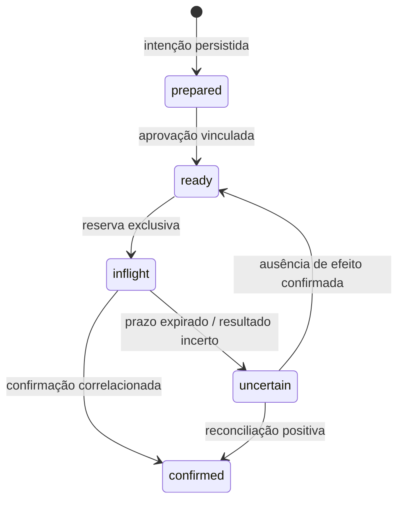

# Confiabilidade: da intenção ao resultado confirmado

Uma integração empresarial precisa preservar significado quando a rede falha. A pergunta relevante após um timeout é se a operação ocorreu, e quais evidências permitem decidir o próximo passo.

## Contrato de execução

Uma operação precisa de identidade estável, escopo organizacional, conteúdo aprovado e referência de correlação. A chave de idempotência identifica uma intenção de negócio; reutilizar a mesma chave com conteúdo diferente deve ser conflito, não atualização silenciosa.

No [código de referência](../src/portfolio_lab/execution.py), a aprovação vincula organização, chave e digest. A identidade do aprovador é um dado fornecido por um chamador confiável: o módulo não implementa autenticação e não deve ser exposto diretamente a um modelo ou cliente remoto.

## Persistência e concorrência

Preparação, aprovação e eventos de auditoria são persistidos no mesmo banco SQLite. A aquisição de uma operação usa transação de escrita e muda o estado antes de devolver a reserva ao executor. Duas conexões concorrentes não podem adquirir a mesma operação pronta.

A reserva contém um token exclusivo e um prazo. Um worker antigo não pode concluir a operação com uma reserva expirada. O registro de estado e o evento correspondente são atômicos. SQLite permite reproduzir o mecanismo localmente; isso não estabelece disponibilidade distribuída ou capacidade de tráfego empresarial.

## A janela de resultado incerto

Se um processo cair depois de um provedor aceitar a ação e antes de persistir a confirmação, repetir automaticamente pode duplicar o efeito. A referência move a reserva expirada para `uncertain`; o worker seguinte não a recebe como tarefa comum.

A reconciliação exige uma observação explícita: efeito encontrado com referência correlacionada, ou ausência de efeito verificada. Somente a segunda permite uma nova tentativa. Em uma integração real, essa observação vem de consulta confiável ao destino, webhook autenticado ou verificação operacional autorizada. Um booleano fornecido pelo modelo não é suficiente.

## Confirmação é um contrato do destino

O recibo sintético usado nos testes exige organização, operação e digest correspondentes. A correlação demonstra integridade do vínculo local; não demonstra autenticidade de um webhook. Autenticidade, semântica do status e proteção contra replay precisam ser verificadas no adaptador do provedor.

| Falha | Comportamento esperado | Prova local |
|---|---|---|
| Chave repetida com mesma intenção | Recuperar registro existente | Idempotência de preparação |
| Chave repetida com outra intenção | Rejeitar conflito | Conteúdo divergente |
| Duas aquisições concorrentes | Uma reserva vencedora | Duas conexões SQLite |
| Processo reiniciado | Preservar estados e eventos | Reabertura do arquivo |
| Confirmação de outra operação | Rejeitar sem concluir | Correlação inválida |
| Reserva expirada | Impedir conclusão pelo worker antigo | Fencing por token e prazo |
| Resultado desconhecido | Quarentena para reconciliação | Sem redrive automático |
| Falha entre estado e auditoria | Reverter ambos | Injeção de falha na transação |

## Limites deliberados

Não se promete efeito externo exatamente uma vez. O ledger controla intenção, reservas e confirmação local; o destino também precisa oferecer idempotência ou uma forma confiável de reconciliação. O exemplo não implementa transporte, autenticação, scheduler, criptografia do arquivo, fila distribuída ou integração direta com LangGraph. Esses componentes são fronteiras distintas na [arquitetura](arquitetura.md).

Referências: [transações SQLite](https://www.sqlite.org/lang_transaction.html), [retomada e reexecução no LangGraph](https://docs.langchain.com/oss/python/langgraph/interrupts) e [transações compensatórias](https://learn.microsoft.com/en-us/azure/architecture/patterns/compensating-transaction).
