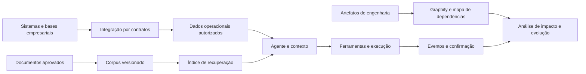

# Engenharia de dados, grafos e fontes de autoridade

Uma solução corporativa com IA precisa conectar informações com funções diferentes: dados de negócio, conhecimento documental, memória, índices de recuperação e evidências de execução. Minha atuação inclui modelagem, integração e decisões de persistência para manter esses vínculos utilizáveis e verificáveis.

## Modelagem orientada ao domínio

| Estrutura | Função | Decisões relevantes |
|---|---|---|
| Banco transacional | Identidade, entidades de negócio, estados e efeitos | Chaves, relacionamentos, transações, migrações e isolamento |
| Base documental | Conteúdo aprovado para consulta e resposta | Origem, versão, vigência, revisão e escopo de acesso |
| Índice de recuperação | Localizar evidência relevante no corpus | Chunking, busca lexical/vetorial, filtros, atualização e avaliação |
| Memória da jornada | Contexto útil para continuidade | Origem, finalidade, expiração, revogação e limite de autoridade |
| Eventos e ledger | Registrar execução e apoiar reconciliação | Correlação, unicidade, estados, concorrência e retenção |
| Grafo estrutural | Navegar dependências e entender impacto | Tipo de nó/aresta, proveniência, cobertura e validade do mapa |

**Repertório:** SQL, PostgreSQL/Supabase, MySQL, Redis e integração por APIs. A escolha parte de consistência, acesso, consulta, operação e custo. Redis pode apoiar cache e estado temporário; índices de recuperação derivam do conteúdo de origem; o sistema transacional continua responsável pelos fatos que controla.

## Graphify como estrutura de engenharia

No projeto de saúde, Graphify apoia a navegação pela estrutura técnica, a localização de componentes e a análise de dependências e proveniência. O valor está em transformar um conjunto extenso de artefatos em relações consultáveis que ajudam a investigar uma mudança.

| Tipo de grafo | Pergunta que responde |
|---|---|
| Execução e estado, como em LangGraph | Qual transição é permitida e com qual contexto? |
| Dependências e proveniência, com apoio de Graphify | Quais componentes se relacionam e onde uma alteração pode repercutir? |
| Conhecimento | Quais entidades e relações possuem sustentação em fontes identificadas? |

Grafo de conhecimento e GraphRAG são escolhas de recuperação a avaliar conforme o problema. O mapa estrutural do Graphify apoia compreensão e manutenção; estado vivo e efeitos empresariais precisam ser consultados e confirmados nos sistemas competentes.

## Arquitetura conceitual

O desenho explicita papéis e fronteiras; preserva a topologia e a implementação dos projetos comerciais.

## Decisões de implementação e operação

- **Integridade:** restrições, transações e chaves de idempotência protegem estados que precisam permanecer coerentes sob repetição e concorrência.
- **Acesso:** organização e identidade confiáveis determinam o escopo da consulta; filtros e ferramentas devem preservar esse limite.
- **Frescura:** alteração da fonte exige política de atualização e invalidação de índice, cache ou memória.
- **Evolução:** migrações e contratos consideram compatibilidade, recuperação e reversão da versão.
- **Continuidade:** backup só sustenta recuperação quando o conjunto restaurado é conferido contra o uso necessário.
- **Observabilidade:** IDs e eventos técnicos permitem diagnosticar execução mantendo o conteúdo sensível sob controle.

## Referências compartilháveis

[Recuperação lexical por organização e versão](../src/portfolio_lab/retrieval.py), [ledger transacional](../src/portfolio_lab/execution.py) e [grafo de proveniência](../src/portfolio_lab/provenance.py) permitem inspecionar mecanismos independentes com dados sintéticos. PostgreSQL/Supabase, MySQL, Redis e Graphify compõem o repertório descrito nos projetos; o código público tem escopo próprio e não reproduz os bancos dos clientes.

Documentação primária: [PostgreSQL](https://www.postgresql.org/docs/current/), [Supabase](https://supabase.com/docs), [MySQL](https://dev.mysql.com/doc/), [Redis](https://redis.io/docs/latest/) e [SQLite FTS5](https://www.sqlite.org/fts5.html). A menção a Graphify corresponde à ferramenta e à estrutura local consultadas no projeto de saúde, sem atribuir certificação externa ao mapa.

[Profundidade técnica](competencias.md) · [Projeto de saúde](casos/atendimento-saude.md) · [Confiabilidade](confiabilidade.md)
