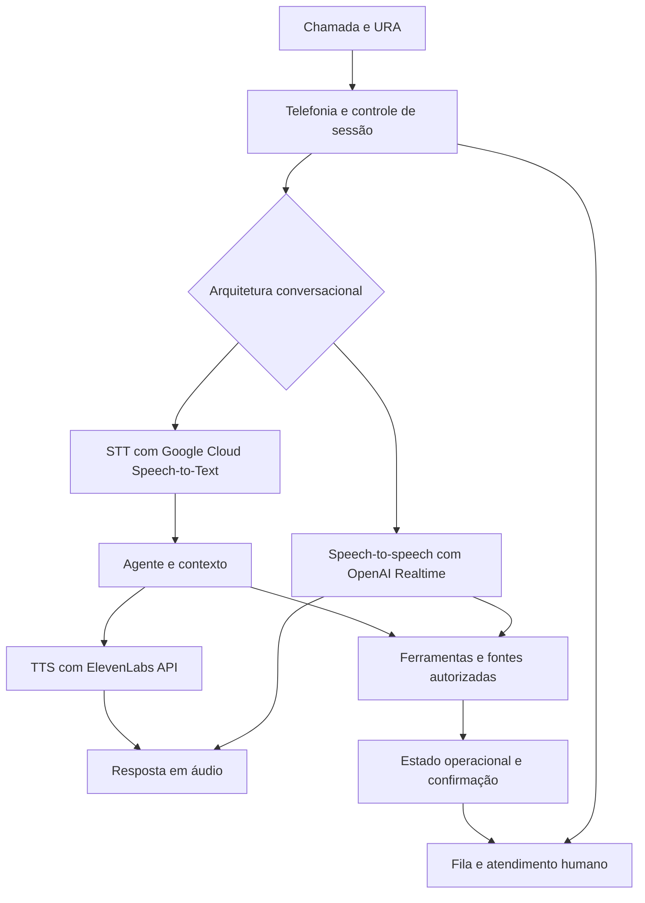

# Engenharia de voz e telefonia — URAs cognitivas e voicebots

**Aplicação profissional:** expansão de uma solução de atendimento em diagnóstico por imagem para voz e telefonia. Minha atuação envolve arquitetura, desenvolvimento dos componentes e integração entre telefonia, agentes, sistemas operacionais e atendimento humano.

O desafio empresarial é preservar a continuidade entre o que a pessoa diz, o que o agente entende, o que a operação consegue executar e o que chega ao atendente. Isso exige coordenar mídia em tempo real, identidade, contexto e efeitos nos sistemas da empresa.

## Arquitetura por responsabilidades

| Camada | Responsabilidade | Repertório técnico |
|---|---|---|
| Telefonia e distribuição | Entrada da chamada, URA, ramais, fila humana e eventos da ligação | Asterisk, SIP, integração com operadora |
| Atendimento no navegador | Sessão do agente humano, registro do ramal e mídia bidirecional | SIP.js, WebRTC e sinalização protegida |
| Conversa em tempo real | Interpretação de áudio, turnos e resposta falada | OpenAI Voice/Realtime |
| Reconhecimento de fala | Converter áudio em texto em uma arquitetura encadeada | Google Cloud Speech-to-Text |
| Síntese de voz | Transformar resposta aprovada em áudio e definir experiência vocal | ElevenLabs API; recursos de áudio do provedor selecionado |
| Orquestração e ferramentas | Contexto, conhecimento, consulta operacional e limites de ação | Agentes, RAG, APIs, MCP quando adequado e orquestração com estado |
| Controle e persistência | Correlação da chamada, estados, eventos, recuperação e observabilidade | Serviços próprios, PostgreSQL e integrações com CRM/atendimento |

A arquitetura combina **componentes open source e APIs de voz**. Telefonia, interface, controle de eventos e persistência possuem responsabilidades próprias; OpenAI, Google Cloud e ElevenLabs são serviços externos integrados por API. A seleção de provedores considera qualidade, latência, custo, privacidade e capacidade de substituição.

## Duas alternativas para a camada conversacional

O diagrama é uma abstração de arquitetura e alternativas de integração. Os provedores não precisam atuar simultaneamente na mesma chamada. A conversa speech-to-speech reduz fronteiras entre reconhecimento e geração; a cadeia STT → agente → TTS permite selecionar e avaliar etapas separadas. Cada opção exige tratamento de interrupção, cancelamento e resposta tardia.

## Decisões que tornam a voz uma solução empresarial

### Telefonia, mídia e operação possuem estados diferentes

Uma sessão sinalizada precisa produzir áudio bidirecional utilizável. Uma rota de transferência precisa chegar a um atendente. Uma resposta sobre agendamento depende do estado observado no sistema competente. Essas confirmações orientam tanto a experiência quanto a recuperação de falhas.

### A URA organiza a jornada e a capacidade de atendimento

Menu, intenção, fila e disponibilidade humana precisam formar uma passagem compreensível. A versão cognitiva incorpora linguagem natural e ferramentas sob contratos explícitos. A migração de uma URA existente exige preservar continuidade e permitir reversão enquanto a nova frente é homologada.

### Identidade e autoridade precisam sobreviver à mudança de canal

Uma transcrição fornece contexto para interpretar a solicitação. A operação exige identidade e autorização compatíveis com a ação. Consulta, proposta e efeito permanecem separados; ações empresariais são confirmadas na fonte competente antes da resposta ao usuário.

### Transferência humana preserva responsabilidade

A transferência inclui motivo e contexto mínimo útil, com acesso compatível com a equipe. Eventos correlacionados permitem acompanhar o aceite humano e lidar com indisponibilidade. O vínculo entre chamada, conversa e sistema corporativo precisa ser mantido sem espalhar conteúdo sensível em logs.

## Critérios de integração e qualidade

| Dimensão | Evidência necessária |
|---|---|
| Sinalização e mídia | Registro, chamada, áudio nos dois sentidos e encerramento correto |
| Conversação | Turnos, interrupções, silêncio, ruído, ambiguidade e reconhecimento de informação crítica |
| Desempenho | Latência por etapa, tempo até primeiro áudio e comportamento sob simultaneidade |
| Ferramentas | Entrada validada, autorização, retorno correlacionado e confirmação do efeito |
| Continuidade humana | Rota, aceite, contexto disponível e recuperação quando ninguém atende |
| Resiliência | Desconexão, timeout, eventos repetidos e reconciliação após falhas |
| Dados | Finalidade, acesso, retenção e tratamento de gravações e transcrições |

**Valor empresarial pretendido:** ampliar os canais de atendimento, preservar contexto entre IA e equipe e conectar a conversa telefônica aos processos da operação. Indicadores de resultado dependem de medição em operação; arquitetura e critérios de integração não substituem evidência de liberação do canal.

## Fontes e escopo

Síntese elaborada com a confirmação de André em 05/10/2026 e a documentação local do projeto de voz e telefonia consultada nesta data. A base consultada descreve controle de chamadas, persistência, Asterisk, SIP/WebRTC e integrações candidatas. O conjunto de provedores de voz foi indicado por André; sua inclusão identifica repertório e desenho de integração.

Documentação primária: [OpenAI Realtime](https://developers.openai.com/api/docs/guides/realtime), [Google Cloud Speech-to-Text](https://docs.cloud.google.com/speech-to-text/docs), [ElevenLabs](https://elevenlabs.io/docs/overview/intro), [Asterisk](https://docs.asterisk.org/) e [SIP.js](https://sipjs.com/guides/).

Código, parâmetros de telefonia, contratos comerciais, identificadores, dados e configuração operacional permanecem privados. Este dossiê apresenta responsabilidades e julgamento de engenharia; não constitui uma certificação do canal telefônico em produção.

[Projeto de saúde](casos/atendimento-saude.md) · [Profundidade técnica](competencias.md) · [Dados e grafos](dados-e-grafos.md)
